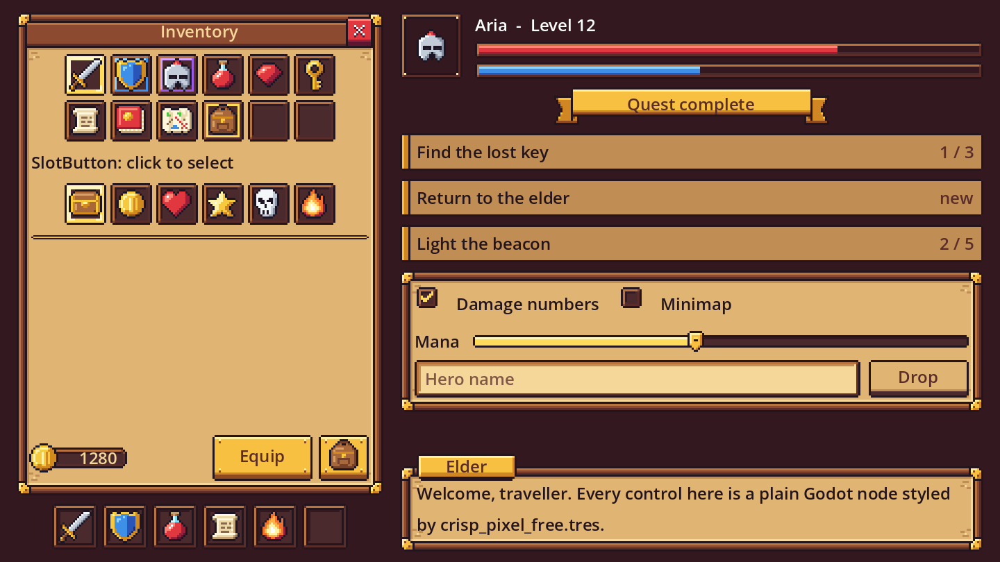

# Crisp Pixel Free Theme

A pixel-art fantasy RPG UI theme, **Oak & Brass**: walnut plank frames, brass corner brackets and tan boards, true pixel art on a
16 px grid. One Godot 4 `Theme` resource styles the standard controls - buttons, check boxes, sliders, health bars, text fields,
panels, separators, item lists, tooltips - and adds type variations for a window, dialogue box, inventory and hotbar slots,
rarity borders, a mana bar, quest rows and more. It comes with the 53 pieces it is built from (35 Oak & Brass pieces and
18 colour icons at 16 x 16), each at 1x, 2x, 3x and 4x, and a Theme for each scale.
It is the free sampler of [Crisp Pixel](https://anipixels.itch.io/crisp-pixel).



## Install

**From the Asset Library (inside Godot):** open the **AssetLib** tab, search for "Crisp Pixel Free Theme", press **Download**, then **Install**.
Everything lands in `res://addons/crisp_pixel_free/`.

**By hand:** download this repository (or `git clone` it) and copy the `addons/crisp_pixel_free` folder into your project,
so that it sits at `res://addons/crisp_pixel_free`. The scenes and resources point at that path, so keep the folder name.

To try the demo, open `res://addons/crisp_pixel_free/demo/pixel_free_demo.tscn` and press **Run Current Scene** (F6).
A `git clone` of this repository also opens as a Godot project of its own and runs the demo with F5
(zip downloads leave `project.godot` out on purpose, so they contain only the `addons/` folder).

## Use

```gdscript
# Whole project: Project Settings > GUI > Theme > Custom = res://addons/crisp_pixel_free/crisp_pixel_free.tres
# Or one branch of the UI, from code:
$Hud.theme = preload("res://addons/crisp_pixel_free/crisp_pixel_free.tres")
$Hud.texture_filter = CanvasItem.TEXTURE_FILTER_NEAREST     # keep the pixels sharp

$Hud/Mana.theme_type_variation = &"ProgressBarMana"           # extra shapes are type variations
$Hud/Bag/Slot1.theme_type_variation = &"SlotRare"             # a PanelContainer, 20 x 20, with a 16 px icon inside
```

Pixel art needs two settings to stay crisp:

1. **Nearest filtering.** Set **Project Settings > Rendering > Textures > Canvas Textures > Default Texture Filter** to **Nearest**,
   or set `texture_filter` to Nearest on the root of your UI (the demo scene does that, so it looks right in any project).
2. **Whole-number scaling.** Either lay out your UI for a small viewport and let Godot scale it up: `crisp_pixel_free.tres` uses the
   1x pieces with the font at 8 px, for viewports of about 320 x 180 to 480 x 270 (**Display > Window > Stretch**: Mode `canvas_items`,
   Aspect `keep`, Scale Mode `integer`, as in this repository's `project.godot`). Or work at full resolution with
   `crisp_pixel_free_2x.tres`, `_3x.tres` or `_4x.tres`, which use the 2x, 3x and 4x pieces with every size multiplied to match.

Fixed-size and fixed-height pieces (noted below) only stretch sideways, if at all: give those nodes the stated size,
multiplied by the scale for the 2x - 4x themes. A mouse cursor is included as a texture:
`Input.set_custom_mouse_cursor(preload("res://addons/crisp_pixel_free/textures/2x/wood/cursor_pointer.png"), Input.CURSOR_ARROW, Vector2(2, 2))`
(the hot spot is at 1, 1 in the 1x art).

## What the theme covers

| Control / type | What it gets | Pieces used |
|---|---|---|
| `Button` (and `OptionButton`, which inherits it) | normal, hover, pressed, disabled | `button_medium_*` (all four states) |
| `CheckBox` | checked / unchecked icons | `checkbox_on`, `checkbox_off` |
| `ProgressBar` | frame and red fill | `bar_frame`, `bar_fill_health` |
| `HSlider` | track, filled part, knob | `slider_track`, `slider_fill`, `slider_knob_normal` |
| `LineEdit`, `TextEdit` | field background | `input_normal` |
| `Panel`, `PanelContainer` | tan board in a walnut frame with brass corners | `panel` |
| `HSeparator` | divider line | `divider` |
| `ItemList` | dark inset panel, row highlight | `panel_inset`, `list_row` |
| Tooltips (`TooltipPanel`, `TooltipLabel`) | dark box, cream text | `tooltip` |
| `Label` | dark text for the tan boards | - |

Type variations (set **Theme > Type Variation** on the node). Sizes are at 1x:

| Variation | Base | Notes |
|---|---|---|
| `ButtonSquare` | Button | square icon button, 20 x 22; a 16 px icon fits the face |
| `ButtonClose` | Button | red close button. Fixed-size art: give the node a size of 13 x 15 |
| `SlotButton` | Button | clickable inventory slot: hover highlight, selected frame when pressed (use `toggle_mode`); 20 x 20 |
| `ProgressBarMana` | ProgressBar | the same bar with the blue fill |
| `Slot`, `SlotHover`, `SlotSelected`, `SlotRare`, `SlotEpic` | PanelContainer | 20 px inventory slots; put a 16 px icon inside |
| `HotbarSlot` | PanelContainer | 22 px hotbar slot |
| `WindowPanel` | PanelContainer | window with a title bar (the top 17 px); put a `LabelTitle` over it |
| `DialogBox`, `NamePlate` | PanelContainer | dialogue box and the name plate (fixed height 13) that overlaps its top-left corner |
| `PanelInset` | PanelContainer | dark sunken area; use `LabelWell` text on it |
| `Ribbon` | PanelContainer | gold title ribbon, fixed height 18 |
| `CurrencyPlate` | PanelContainer | gold counter with a socket for a 16 px coin on the left, fixed height 12 |
| `QuestEntry` | PanelContainer | quest-tracker row, 16 high |
| `ListRow` | PanelContainer | list row, 12 high |
| `TooltipBox` | PanelContainer | the tooltip box as a normal container |
| `PortraitFrame` | PanelContainer | hollow 30 px portrait frame (24 px portrait) |
| `LabelTitle` | Label | cream text for the window title bar |
| `LabelOnAccent` | Label | dark brown text for the gold buttons, ribbon and name plate |
| `LabelWell`, `LabelTooltip` | Label | cream text for the dark inset, currency plate and tooltip |
| `LabelOnDark` | Label | white text placed straight on a dark background |
| `LabelMuted` | Label | secondary brown text |

## What it does not cover

Only pieces that exist in the free sampler are used, so some controls are left alone on purpose:

- **Font**: none is bundled. Crisp Pixel's two pixel fonts are in the full pack only, so the theme uses whatever font the project
  has (Godot's default if you set none) at 8 px per scale step. For a true pixel look, set a pixel font of your own as the theme's
  or the project's default font and turn its anti-aliasing off in the import settings.
- **CheckButton (switch), radio buttons, tabs, scroll bars, popup menus / dropdown lists, trees, spin boxes, vertical sliders, vertical
  separators**: the sampler has no pieces for them. `CheckButton` gets the text colours only and keeps Godot's default switch icon;
  the rest keep Godot's default look. (A `CheckBox` in a `ButtonGroup` shows Godot's default radio icon.)
- **Hover / disabled art for `ButtonSquare` and `ButtonClose`, a hover knob for the slider, a "selected" list row, focus and disabled
  text fields**: not in the sampler. Hover looks like normal, pressed `ButtonClose` darkens the art, disabled ones are the normal art
  faded, read-only fields are the normal field faded, and `ItemList` uses `list_row` for the selected row.
- **Focus art**: keyboard focus is drawn as a 1 px square outline with anti-aliasing off (a `StyleBoxFlat`, not one of the pack's pieces).
- **Other themes**: Oak & Brass only. `cursor_pointer` is included as a texture but is not part of the Theme (see below).

## What is in it

220 files, 212 KB. The 212 PNGs are the sampler's 53 pieces at 1x, 2x, 3x and 4x (enlarged with no smoothing, so
every pixel becomes a 2, 3 or 4 px square). Every pixel is fully opaque or fully transparent. The icons and the cursor are not part
of the Theme but are there for your buttons and HUD (see the demo scene).

- `./` - `LICENSE.txt`, `README.md`, `crisp_pixel_free.tres`, `crisp_pixel_free_2x.tres`, `crisp_pixel_free_3x.tres`, `crisp_pixel_free_4x.tres`
- `demo/` - `pixel_free_demo.gd`, `pixel_free_demo.tscn`
- `textures/1x/icons/` - 18 files (.png)
- `textures/1x/wood/` - 35 files (.png)
- `textures/2x/icons/` - 18 files (.png)
- `textures/2x/wood/` - 35 files (.png)
- `textures/3x/icons/` - 18 files (.png)
- `textures/3x/wood/` - 35 files (.png)
- `textures/4x/icons/` - 18 files (.png)
- `textures/4x/wood/` - 35 files (.png)

## Full pack

**[Crisp Pixel on itch.io](https://anipixels.itch.io/crisp-pixel)** has **139 pieces in each of 6 themes** (Oak & Brass, Stone & Ember, Parchment & Ink, Royal Gold,
Arcane, Classic Blue - different drawings, not recolours) and **157 colour icons** - 991 sprites (3964 PNG files at 1x - 4x), sprite
sheets, **two pixel fonts**, palette files and a Godot 4 theme per theme at every scale. Those themes cover what this one cannot:
large, small, secondary, round and arrow buttons, switch and radio art, tabs, scroll bars, dropdown lists, focus and disabled
fields, all five rarity borders, stamina and experience bars, orbs, toasts and an ornate panel.

Or get every Crisp pack in one bundle: [Crisp Everything Bundle](https://itch.io/s/203391/crisp-everything-bundle).

## Godot version

Written for **Godot 4.3 and newer** (GDScript only, no C#, no GDExtension, no feature known to need 4.4 or later).
Tested on **Godot 4.7.2 stable (the .NET editor build, run headless on Windows 11)**: headless import plus a script that loads every file and exercises the public API,
with no errors or warnings. It has **not** been run on 4.3 - 4.6; if something misbehaves there, please open an issue.

The demo scene was also rendered once in a real window at 3x to make `screenshot.png`; individual hover, pressed and focus states
were checked by loading, not by eye.

## Licence

This free repository has two licences, both standard and both fine for commercial games:

- **Assets** - the images (PNG), Theme resources (.tres) and the demo scene (.tscn) - are under **Creative Commons Attribution 4.0 International (CC BY 4.0)**.
  Use, edit and ship them in anything, including commercial projects, as long as you give credit.
  A line like this in your credits is enough: `Crisp Pixel Free Theme by Anipixels - https://anipixels.itch.io/crisp-pixel`
- **Code** - every `.gd` file - is under the **MIT licence**.

See `LICENSE` (assets) and `LICENSE-CODE` (code); a copy of both is in `addons/crisp_pixel_free/LICENSE.txt`.
This applies to the files in this repository only. The paid full pack has its own licence (no attribution needed, no redistribution).

## How it was made

The images are generated procedurally by code written with an AI assistant (Claude). No AI image or audio generators were used, and nothing is traced or taken from third-party assets.
